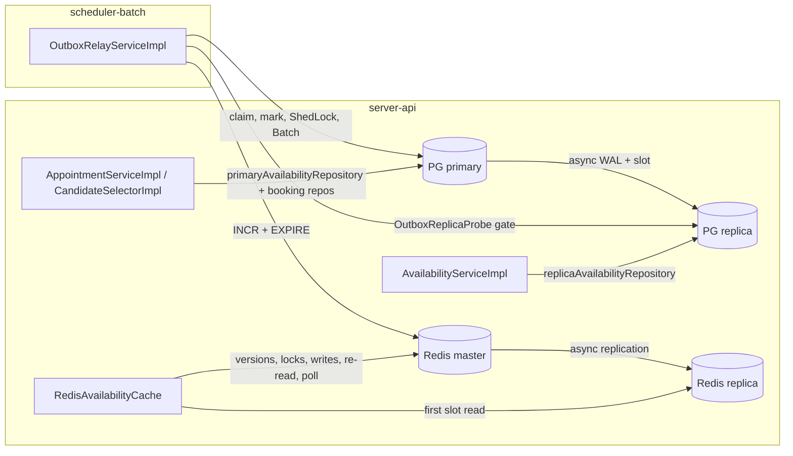

# Architecture Spine — keyloop replication

## Design Paradigm

Primary/replica data tier with a **CQRS-lite split bound per bean**: every repository/cache bean is wired to exactly one connection role. Request-time routing (routing DataSource, `readOnly` flags) is not used. Layering (CLAUDE.md §1, ArchUnit ARC-01…08) is unchanged; replica awareness lives only in config and repository/cache/store implementations.



## Invariants & Rules

### AD-1 — Topology: one primary + one replica per store [ADOPTED]

- **Binds:** docker-compose.yml
- **Prevents:** extra HA components, Bitnami images, writable replicas, sync-commit stalls.
- **Rule:** Services `postgres-1`, `postgres-2`, `redis-1`, `redis-2` on official `postgres:18-alpine` / `redis:8-alpine` (no Bitnami). Which node is primary/master is set in `.env` (`PG_PRIMARY=postgres-1`, `REDIS_MASTER=redis-1`), never implied by the service name. Postgres replication is **asynchronous** with one physical replication slot. Redis is cache-only (no AOF/RDB) on both nodes; replica runs `--replicaof $REDIS_MASTER 6379 --replica-serve-stale-data no`. Data services have **no `restart:` policy** (an empty auto-restarted Redis master would wipe its replica; a restarted old PG primary would be writable).

### AD-2 — Manual failover via scripts, fixed names [ADOPTED]

- **Binds:** `scripts/db-failover.sh`, `scripts/redis-failover.sh`, runbook
- **Prevents:** split-brain (two writable nodes) after a promote, or a stale old primary picked first by pgjdbc.
- **Rule:** Failover scripts run in this order and nothing else may promote: stop the old primary container → `SELECT pg_promote()` / `REPLICAOF NO ONE` on the replica → flip `PG_PRIMARY` / `REDIS_MASTER` in `.env` → **delete the old primary's volume** → `docker compose up -d` re-seeds it as replica (AD-8). Redis failover also runs `FLUSHALL` on the new master and restarts `server-api` and `scheduler-batch` (Lettuce static master/replica detects roles only at connect).

### AD-3 — Connection beans and Spring wiring

- **Binds:** server-api and scheduler-batch config, health groups
- **Prevents:** Flyway/Batch/ShedLock/JdbcTemplate/transaction manager binding to the replica; Redis timeout (REL-05) lost on hand-built factories.
- **Rule:**
  - Postgres primary DataSource stays Boot auto-configured from `spring.datasource.*` (URL `jdbc:postgresql://${DB_HOSTS}/…?targetServerType=primary`; batch keeps `currentSchema=batch,public` and REL-06 init-sql). It backs every framework user and the default `JdbcClient`.
  - Replica DataSource is `@Bean(defaultCandidate = false)` + `@Qualifier`, from `scheduler.datasource.replica.*`, URL `targetServerType=preferSecondary` (server-api) / `secondary` (relay gate), `readOnly=true`, `maxLifetime` 60s, max pool 5. A `replicaJdbcClient` is built on it.
  - Redis master factory is Boot auto-config (`spring.data.redis.masterreplica.nodes`, `lettuce.read-from: upstream`, `timeout: 1s`) and backs the default template. server-api adds a replica factory + template, `defaultCandidate = false`, built from the same `RedisProperties` (same timeout) with `ReadFrom.REPLICA_PREFERRED`. scheduler-batch has exactly one Redis factory (master).
  - Bean names and qualifiers live in a constants class per app (`DataSourceNames`, `RedisNames`).

### AD-4 — Replica access is bound per bean, enforced by ArchUnit

- **Binds:** server-api `repository/availability`, `service/*`; scheduler-batch `repository/outbox`; both `ArchitectureTest`
- **Prevents:** booking (overlap check, candidate selection, reference data) reading a lagging replica because it shares `AvailabilityRepository` with the read path.
- **Rule:** `JdbcAvailabilityRepository` is registered twice: `primaryAvailabilityRepository` and `replicaAvailabilityRepository`. Only `AvailabilityServiceImpl` injects the replica one; `AppointmentServiceImpl` and `CandidateSelectorImpl` inject the primary one. Every injection of a dual-role interface uses `@Qualifier`. Everything else — booking, outbox, Flyway, ShedLock, Batch, heartbeat probe, simulator — is primary only. **ARC-09:** only `AvailabilityServiceImpl` and `OutboxRelayServiceImpl` may depend on a replica-qualified bean.

### AD-5 — Relay replica-visibility gate before INCR [ADOPTED]

- **Binds:** scheduler-batch `OutboxRelayServiceImpl`, `OutboxReplicaProbe` / `JdbcOutboxReplicaProbe`, `OutboxRelayProperties`
- **Prevents:** a cache rebuild after the version bump reading a stale replica and pinning old slots under the new version.
- **Rule:**
  - Per claimed row, between TX A (claim) and TX B (relock/INCR/mark), **outside any transaction**: poll `OutboxReplicaProbe.isVisible(eventId)` until true or `gateTimeout`.
  - The probe first checks `pg_is_in_recovery()` on its own connection; `false` means it is not on a replica → evict that connection and re-check (never count it as visible).
  - Replica unreachable or `gateTimeout` hit → the row takes the existing Spec04 retry → FAILED path and the tick stops.
  - `gateTimeout` and `gatePollInterval` live in `OutboxRelayProperties`, validated at startup.
  - Accepted residual risk: a reader whose own connection sits on a lagging node can still cache stale slots for ≤ slot TTL (60s); Postgres still rejects double booking (409).

```
TX A claim E1 ─► gate: in_recovery? ✓  E1 visible on replica? ✓ ─► TX B: INCR v3→v4, PROCESSED
```

### AD-6 — Redis routing by key family [ADOPTED]

- **Binds:** server-api `RedisAvailabilityCache`; scheduler-batch `RedisAvailabilityVersionStore`, heartbeat probe
- **Prevents:** stale version reads (old cache served), lock stampede protection lost to replica lag, silent zero hit rate when the replica link breaks.
- **Rule:** Version keys (`GET`/`MGET`), lock `SET NX`/release, slot `SET`, `INCR`/`EXPIRE` → master template. Only a request's **first** slot-list `GET`/`MGET` → replica template; a replica miss is re-read once on the master before taking the lock. The post-lock double-check and lock-wait polling read the master only. A `MASTERDOWN`/stale-data error from the replica is a cache miss, not "Redis off". Covered by a unit test per call site.

### AD-7 — Replica loss degrades, never fails readiness

- **Binds:** actuator health groups, both apps
- **Prevents:** a replica outage taking the API out of nginx.
- **Rule:** Readiness includes only the primary `db` and the master Redis connection. Replica health is exposed as `dbReplica` / `redisReplica`, outside readiness. An integration test stops the replica and asserts readiness stays UP. REL-05 fail-open is unchanged for the master.

### AD-8 — Data-tier bootstrap

- **Binds:** `infra/postgres/init`, `infra/postgres/replica-entrypoint.sh`, docker-compose.yml
- **Prevents:** replica unable to connect (default `pg_hba` `all` does not match replication), WAL removed before replay, standby refusing to start, query cancellation 500s.
- **Rule:**
  - Primary init script (idempotent, runs on an empty volume only): create role `${PG_REPL_USER}` with `REPLICATION` (password `${PG_REPL_PASSWORD}` from `.env`), append `host replication ${PG_REPL_USER} all scram-sha-256` to `pg_hba.conf`, create physical slot `replica_slot`.
  - Replica uses a wrapper entrypoint: if `PGDATA` is empty → `pg_basebackup -h $PG_PRIMARY -U $PG_REPL_USER -D $PGDATA -R -X stream -S replica_slot`, then exec the stock entrypoint.
  - Both nodes: `max_connections=200`, `hot_standby_feedback=on`, `wal_level=replica`.
  - Healthchecks: primary `pg_isready`; replica `pg_isready` + `pg_is_in_recovery()`. Apps `depends_on` the primary healthy only.
  - Hikari budget: (primary pool + replica pool) × max instances of both apps ≤ 190.
  - Moving from the current single node needs one `docker compose down -v` (existing `pg-data` never re-runs init).

### AD-9 — Host discovery by node list

- **Binds:** docker-compose.yml, `infra/k8s`, `loadtest/simulator`, `scripts/run-app.sh`, `.env.example`
- **Prevents:** half the consumers still pointing at a retired single host.
- **Rule:** `DB_HOSTS=postgres-1:5432,postgres-2:5432` and `REDIS_NODES=redis-1:6379,redis-2:6379` replace `DB_HOST`/`DB_PORT`/`REDIS_HOST`/`REDIS_PORT` in every consumer, in the same change. Host ports for IDE runs: 5432/5433, 6379/6380.

## Deferred

- Automatic failover (Sentinel ×3, Patroni/repmgr) — revisit if the demo needs self-healing.
- LSN-based read-your-writes guard on the reader — revisit if the ≤60s residual window (AD-5) becomes visible in demos.
- More than one replica — reopens AD-5 (gate must cover every replica) and AD-3 pool budget.
- Replication-lag metrics/alerts — revisit with observability work.
- k8s StatefulSets for the data tier — compose only; k8s manifests get only the AD-9 env change.
- Testcontainers with a real replica — tests point both DataSources at one container unless a test needs lag.
