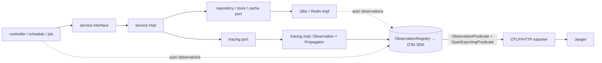
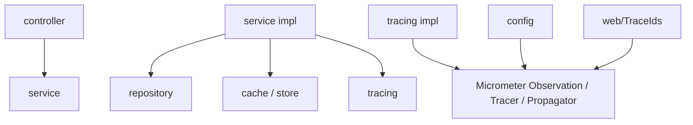
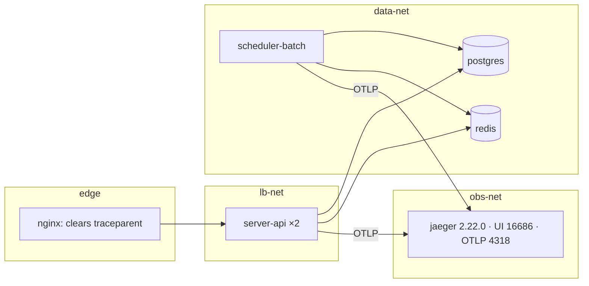

# Architecture Spine — keyloop distributed tracing

## Design Paradigm

Layered MVC as in CLAUDE.md §1. Tracing is cross-cutting. Framework instrumentation makes the HTTP, JDBC, Redis, `@Scheduled` and Batch spans with no code in the layers. A business span (`outbox.write`, `outbox.work`) is created only through a **feature port**. The port is an interface in `tracing/<feature>/`, with its Micrometer implementation in `tracing/<feature>/impl/`, and only services call it.



## Inherited Invariants

| Inherited | From parent | Binds here |
| --- | --- | --- |
| Layering + ArchitectureTest ARC-01…08 | CLAUDE.md §1, Spec05 §7 | `tracing/` follows the interface → impl shape of `repository/`. AD-10 extends the rules |
| No literals | CLAUDE.md §3 | Names go in constants. Endpoint and sampling go in `application.yml` from env vars |
| Tracing only, OTLP straight to Jaeger, no collector | DLD §12 | No OTel Collector, Prometheus or Grafana |
| `correlationId` from nginx `X-Request-Id` | Spec02 API-16, `RequestIdFilter` | Stays. `traceId` is added next to it |
| Outbox: link, not parent; no span on an empty tick | story-outbox-tracing §2 | Fixed by AD-3 and AD-9 |

## Invariants & Rules

### AD-1 — One tracing stack; business spans are Observations

- **Binds:** server-api, scheduler-batch
- **Prevents:** two tracers in one JVM; a span built with `Tracer.spanBuilder` that the observation-based filters cannot see, so its JDBC and Redis children go missing.
- **Rule:**
  - Both apps use `spring-boot-starter-opentelemetry`. JDBC spans come from `datasource-micrometer-spring-boot`. Do not use the OTel Java agent, the community OTel starter or the raw OTel SDK.
  - A business span is an `Observation` started on the `ObservationRegistry`.
  - `Tracer` and `Propagator` are used only to read the current context, to inject or extract `traceparent`, and to add a link.

### AD-2 — Export is OTLP/HTTP, configured by environment, never blocking

- **Binds:** both apps, docker-compose
- **Prevents:** a Jaeger outage slowing down or failing bookings; endpoints hard-coded per machine.
- **Rule:** The endpoint (`management.opentelemetry.tracing.export.otlp.endpoint`) and the sampling ratio (`management.tracing.sampling.probability`) come from env vars `TRACING_OTLP_ENDPOINT` and `TRACING_SAMPLING_PROBABILITY`. The exporter is the async batch exporter. Apps do not `depends_on` Jaeger.

### AD-3 — No noise traces, filtered in two places

- **Binds:** both apps
- **Prevents:**
  - About 170 000 empty relay traces per day per batch instance.
  - About 8 600 health-check traces per day per container.
  - A filter that also drops wanted Redis children: Lettuce sets its parent on the event loop, after an `ObservationPredicate` has already run.
- **Rule:**
  - An `ObservationPredicate` (in `config/tracing/`, both apps) drops these at start:
    - in scheduler-batch, `tasks.scheduled.execution` when the target class is `OutboxRelay` (match with `ClassUtils.getUserClass`, because ShedLock proxies the bean);
    - in both apps, `http.server.requests` on the actuator base path.
  - A `SpanExportingPredicate` (in `config/tracing/`, both apps) drops, at export time, every **root** span whose name starts with `jdbc.` or `lettuce`.
  - JDBC and Redis spans that have a parent are never dropped.
  - `outbox.claim` opens only after a row is returned.

### AD-4 — Every API error body carries `traceId`

- **Binds:** server-api `ApiExceptionHandler`
- **Prevents:** some error paths with the id and some without; clients with no id to quote.
- **Rule:**
  - `ApiExceptionHandler` is the only place that sets the ProblemDetail property `ErrorMessages.TRACE_ID_PROPERTY`. It sets it on every error, including the paths inherited from `ResponseEntityExceptionHandler`.
  - It reads the id through `web/TraceIds`.
  - The id is present whenever a span exists, even an unsampled one, so the logs still match. When no span exists, the property is left out.

### AD-5 — Jaeger is local infrastructure on its own network

- **Binds:** docker-compose, nginx
- **Prevents:** the edge reaching Jaeger; Jaeger on the data network; unbounded memory.
- **Rule:**
  - Jaeger all-in-one is pinned to an exact version and uses its built-in in-memory store, which keeps at most 100 000 traces by default.
  - It runs on a new `obs-net` network that only the two apps join.
  - UI port 16686 is published, and OTLP 4318 too, for IDE runs.

### AD-6 — Logs carry both ids

- **Binds:** common-logging `log4j2-spring.xml`
- **Prevents:** log lines that cannot be matched to a trace.
- **Rule:** The log pattern prints `[%X{correlationId}] [%X{traceId},%X{spanId}]`. Only Micrometer Tracing writes the `traceId` and `spanId` MDC keys.

### AD-7 — Naming and constants ownership

- **Binds:** every custom span and tag, both apps
- **Prevents:** `appointment.write` vs `outbox.write`; `event.id` spelled two ways in two apps; two classes both called `TracingConstants` doing different jobs.
- **Rule:**
  - **Span names:** `<concept>.<verb>`, lowercase, joined with dots. The concept is the business concept, not the code package. Outbox spans are `outbox.*` in both apps.
  - **Tag names:** lowercase `dot.case`.
  - **Names used by both apps** (outbox span and tag names) live in one class, `common-logging` `com.keyloop.scheduler.logging.TraceAttributes`.
  - **Names used by one app** live in that feature's existing constants (`RelayConstants`, `AppointmentConstants`).
  - **Each app's `constant/TracingConstants`** holds only the framework observation names the predicates match.
  - Ports are named after the feature component that uses them: `RelayTracing`, `OutboxWriteTracing`.
  - No customer personal data goes into any tag.

### AD-8 — Identity, propagation, sampling

- **Binds:** both apps, nginx, docker-compose
- **Prevents:** a client forcing sampling with its own `traceparent`; the two apps sampled at different ratios; a second, link-aware sampler built by one story only.
- **Rule:**
  - `service.name` = `spring.application.name`.
  - Propagation is W3C `traceparent`.
  - Sampling is the stock parent-based ratio sampler only. The ratio is one `TRACING_SAMPLING_PROBABILITY` value in compose `x-app-env`.
  - nginx clears inbound `traceparent` and `tracestate`, so every trace starts at server-api.

### AD-9 — `outbox_events.trace_parent` is the cross-app trace contract

- **Binds:** server-api outbox writer, scheduler-batch relay
- **Prevents:** a hand-formatted string with `-null` in it; the context stored inside the JSON payload instead; a regex parser and `Propagator.extract` that accept different strings.
- **Rule:**
  - The column is the only carrier.
  - It holds exactly the W3C `traceparent` header value of the `outbox.write` span.
  - The value is made only with `Propagator.inject` and read only with `Propagator.extract`, both inside `tracing/**/impl`. Services and repositories pass it as an opaque `String`.
  - It is written only when that span is sampled; otherwise it is `NULL`. A `NULL` or unreadable value means no link, and the row is still processed.
  - The relay links to the context and never uses it as a parent.
  - `relay.lag.ms` is computed in the claim SQL (`now() − created_at`).

### AD-10 — ArchitectureTest owns the tracing rules

- **Binds:** both apps' `ArchitectureTest`. story-tracing-baseline adds these rules; later stories add classes only.
- **Prevents:** the first `tracing/` class failing ARC-08; a controller or repository calling a tracing port; two stories each adding their own rule.
- **Rule:**
  - ARC-08 accepts `.tracing..`.
  - ARC-05 covers `..tracing.*` (interfaces only).
  - New **ARC-09:** `Tracer`, `Propagator` and `ObservationRegistry` are used only in `..tracing..impl..`, `..config..` and `web/TraceIds`.
  - New **ARC-10:** only `..service..impl..` depends on `..tracing..` interfaces.



## Consistency Conventions

| Concern | Convention |
| --- | --- |
| Cross-app names | `common-logging` `TraceAttributes`: span names `outbox.write`, `outbox.claim`, `outbox.work`; tags `event.id`, `event.type`, `outcome`, `attempts`, `relay.lag.ms` |
| Error shape | ProblemDetail plus `traceId`, 32 lowercase hex characters; key in `ErrorMessages.TRACE_ID_PROPERTY` |
| JDBC spans | `jdbc.includes: QUERY`: one span per statement |
| Config | A `TRACING_*` env var maps to a `management.*` / `jdbc.*` property. No `@ConfigurationProperties` class, because Boot owns these properties |
| Tests | `opentelemetry-sdk-testing` `InMemorySpanExporter` as a test `@Bean`, plus `@AutoConfigureTracing`. Never call Jaeger from a test |

## Stack

| Name | Version |
| --- | --- |
| Spring Boot (BOM) | 4.1.2 |
| spring-boot-starter-opentelemetry | from Boot BOM (4.1.2) |
| io.opentelemetry:opentelemetry-sdk-testing (test) | from Boot BOM |
| net.ttddyy.observation:datasource-micrometer-spring-boot | 2.3.0 |
| Jaeger all-in-one (`cr.jaegertracing.io/jaegertracing/jaeger`) | 2.22.0 |

## Structural Seed



```text
common-logging/.../logging/TraceAttributes           # cross-app span/tag names
server-api/.../api/
  config/tracing/   NoiseObservationPredicate, RootSpanExportingPredicate
  constant/TracingConstants                          # framework observation names
  web/TraceIds
  tracing/appointment/ OutboxWriteTracing (+ impl/)  # story-outbox-tracing
scheduler-batch/.../batch/
  config/tracing/   NoiseObservationPredicate, RootSpanExportingPredicate
  constant/TracingConstants
  tracing/outbox/   RelayTracing (+ impl/)           # story-outbox-tracing
```

## Deferred

- **Metrics, OTel Collector, Prometheus/Grafana.** ROADMAP:154. Revisit when a second telemetry consumer exists.
- **Production sampling ratio and tail sampling.** Needs real traffic. Set at deploy time. A linked pair survives with probability p², and that is accepted for now.
- **Persistent Jaeger storage.** In-memory is enough until there is a shared environment.
- **nginx spans and OTLP log export / JSON logs** (DLD §12 target).
- **Async/executor context propagation.** There is no `@Async` today. Add `ContextPropagatingTaskDecorator` when one appears.
